# Plataforma de gestión académica

> **Estado del proyecto:** Implementación completada, validada y desplegada exitosamente en **AWS** bajo arquitectura de microservicios y flujo **GitOps** con **GitHub Actions (CI)**, **Amazon ECR**, **Amazon EKS** y **Argo CD (CD)**.

---

## 1. Problemática

Un centro de formación necesita administrar su oferta de cursos, los datos de sus estudiantes y sus matrículas. Cuando esta información se mantiene en hojas de cálculo o registros separados, resulta difícil conocer las plazas disponibles en tiempo real, evitar matrículas duplicadas y mantener la información actualizada. Además, coordinar cambios entre registros requiere trabajo manual y puede producir inconsistencias en la capacidad de las aulas.

El taller plantea también un reto técnico de computación en la nube: construir dos servicios independientes con tecnologías y bases de datos propias, integrarlos en una interfaz común y desplegarlos en Kubernetes sobre AWS con prácticas de integración y entrega continua (CI/CD).

---

## 2. Solución propuesta y Tecnologías

Se desarrolló una plataforma web para la administración académica que permite gestionar cursos, estudiantes y matrículas, visualizando la información consolidada desde un único frontend. La solución está compuesta por dos microservicios con responsabilidades y bases de datos completamente independientes:

| Componente | Tecnología | Responsabilidad |
| :--- | :--- | :--- |
| **Servicio de cursos** | Java 21 y Spring Boot | Administración de cursos, estados, capacidad y reserva atómica de plazas. |
| **Servicio de estudiantes** | Python 3.12 y FastAPI | Gestión de estudiantes, asignación de matrículas y ciclo de vida del alumno. |
| **Frontend** | React y Vite | Interfaz web interactiva, panel de control y formularios de administración. |
| **Bases de datos** | Dos bases PostgreSQL independientes | Aislamiento de datos y credenciales por microservicio (`cursos-db` y `estudiantes-db`). |
| **Contenedores y Registro** | Docker y Amazon ECR | Empaquetado en imágenes ligeras y publicación en registros privados de AWS. |
| **Orquestación y GitOps** | Amazon EKS y Argo CD | Clúster gestionado de Kubernetes y sincronización declarativa continua. |

Cada backend utiliza **arquitectura hexagonal (puertos y adaptadores)**: el dominio y los casos de uso forman el núcleo puro, mientras que las capas HTTP, la persistencia en PostgreSQL y la comunicación entre servicios se implementan como adaptadores desacoplados.

---

## 3. Funcionalidades implementadas

### Cursos
- Registro, consulta detallada, edición y búsqueda paginada de cursos por nombre o código.
- Activación y desactivación de cursos con validaciones de negocio.
- Cálculo de vacantes y plazas disponibles en tiempo real.
- Reserva y liberación atómica de plazas con cabecera de idempotencia (`Idempotency-Key`).
- Bloqueo automático de inscripciones en cursos inactivos o con capacidad agotada.

### Estudiantes y Matrículas
- Registro, consulta, búsqueda y actualización de información de estudiantes.
- Matrícula de estudiantes activos en cursos con plazas disponibles mediante saga distribuida.
- Prevención de matrículas duplicadas o conflictivas para un mismo alumno en un curso.
- Consulta de historial de matrículas por estudiante y listados por asignatura.
- Cancelación de matrícula con liberación automática de la vacante reservada.

### Frontend
- Panel de control principal con indicadores numéricos vivos (cursos activos, estudiantes activos y matrículas confirmadas).
- Módulos interactivos dedicados para Cursos, Estudiantes y Matrículas con paginación y búsqueda.
- Manejo intuitivo de errores de validación, estados de carga y retroalimentación al usuario.

---

## 4. Arquitectura de la aplicación

```text
Navegador Web
     │
     ▼
Balanceador de Carga AWS (LoadBalancer)
     │
     ▼
Frontend React (Nginx Proxy)
     ├─ /api/v1/cursos ───────────► Servicio Cursos (Java Spring Boot) ──► BD cursos (PostgreSQL)
     │                                      ▲
     │                                      │ (Reserva / Liberación de plazas HTTP)
     │                                      │
     └─ /api/v1/estudiantes & matriculas ─► Servicio Estudiantes (FastAPI) ──► BD estudiantes (PostgreSQL)
```

### Comunicación y Contratos OpenAPI
Los microservicios se comunican mediante **HTTP y APIs REST** con contratos versionados:
* **Servicio de cursos:** Especificación OpenAPI 3.0 documentada en [servicios/cursos/openapi.yaml](servicios/cursos/openapi.yaml) y Swagger UI en `/swagger-ui/index.html`.
* **Servicio de estudiantes:** Especificación OpenAPI 3.1 documentada en [servicios/estudiantes/openapi.yaml](servicios/estudiantes/openapi.yaml) y Swagger UI en `/docs`.

---

## 5. Infraestructura y Flujo GitOps (CI/CD)

```text
Código en Git (rama developer)
       │
       ▼
GitHub Actions (CI) ──► Ejecuta pruebas unitarias (>80 % cobertura) y empaqueta Docker
       │
       ▼
Amazon ECR ───────────► Almacena las imágenes versionadas con el SHA del commit
       │
       ▼
Git (Kustomize) ──────► Manifiestos actualizados con las referencias de imagen
       │
       ▼
Argo CD (GitOps) ─────► Detecta cambios en Git y sincroniza el estado deseado
       │
       ▼
Amazon EKS ───────────► Nodos EC2 descargan las imágenes de ECR y ejecutan los Pods
```

---

## 6. Inicio y Trazabilidad del Harness

El proyecto implementa un arnés de ingeniería para verificación rigurosa de criterios de aceptación:
- [harness/WORKFLOW.md](harness/WORKFLOW.md): Flujo de trabajo y ciclo de vida de tareas.
- [harness/features.json](harness/features.json): Catálogo de las 20 funcionalidades del sistema (**100 % passed**).
- [harness/TRACEABILITY.md](harness/TRACEABILITY.md): Matriz de trazabilidad entre specs, issues, PRs y evidencias.
- [harness/PROGRESS.md](harness/PROGRESS.md): Registro histórico de avances y validaciones.

---

## 7. Evidencias del Proceso de Implementación y Despliegue en AWS

A continuación se presentan las evidencias ordenadas cronológicamente del ciclo completo de validación, construcción, publicación y despliegue en producción:

### Paso 1: Pruebas Unitarias y Medición de Cobertura (CI)
Cada backend supera de forma estricta el umbral del 80 % de cobertura de líneas de código exigido por las especificaciones.

* **Evidencia 1.1 — Cobertura de Cursos con JaCoCo (87 %):**  
  El servicio de cursos alcanzó una cobertura de líneas del **87 %** comprobada en el reporte JaCoCo.  
  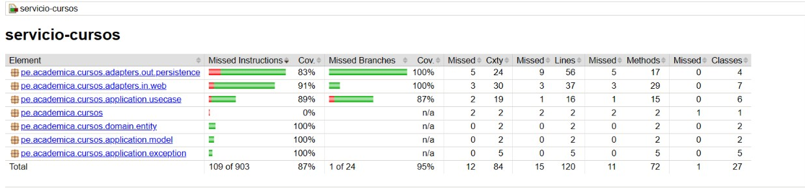

* **Evidencia 1.2 — Artefactos de Reportes en GitHub Actions:**  
  Generación y conservación automática de los reportes descargables (`reportes-cursos` y `reportes-estudiantes`).  
  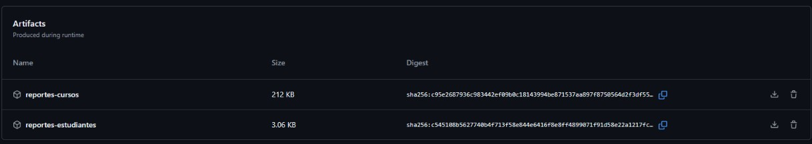

---

### Paso 2: Pipeline Automatizado de Integración en GitHub Actions (CI/CD)
Construcción y publicación automatizada mediante `.github/workflows/ecr-publicacion.yml`.

* **Evidencia 2.1 — Ejecución Exitosa del Workflow:**  
  Validación en paralelo de los tres componentes y autenticación segura con AWS mediante **OIDC** (OpenID Connect) sin almacenar credenciales permanentes, publicando las imágenes asociadas al commit `ef354c8`.  
  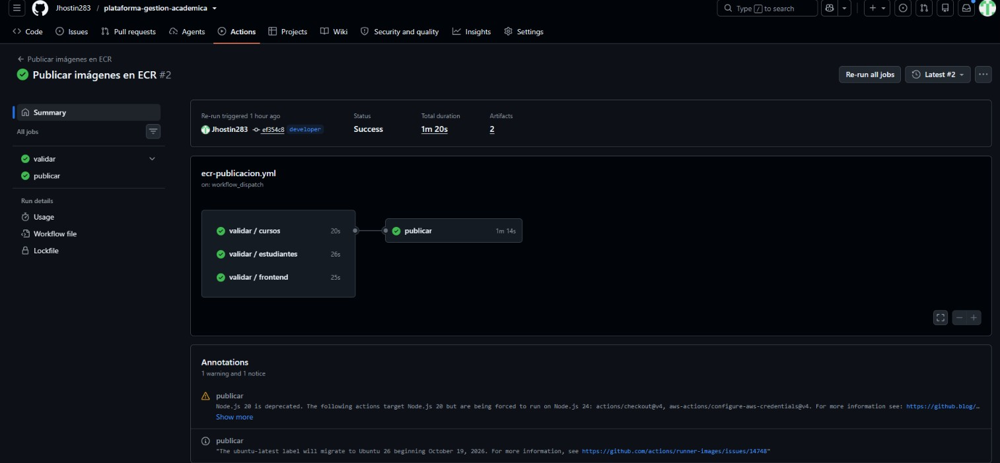

---

### Paso 3: Publicación de Imágenes en Amazon ECR
Almacenamiento de las imágenes construidas en el registro privado de contenedores de AWS.

* **Evidencia 3.1 — Repositorios Privados en Amazon ECR:**  
  Repositorios creados en la región `us-east-1` (`academia/cursos`, `academia/estudiantes`, `academia/frontend`).  
  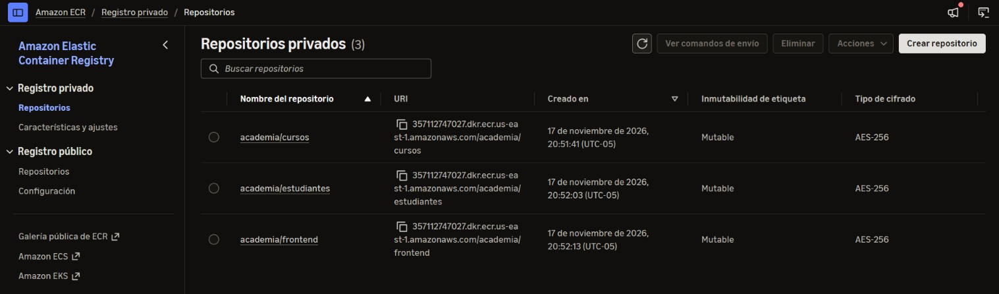

---

### Paso 4: Infraestructura de Cómputo en Amazon EKS y EC2
Aprovisionamiento del clúster de Kubernetes y sus nodos de cómputo en AWS.

* **Evidencia 4.1 — Clúster Amazon EKS Activo:**  
  Clúster `academia-cluster` aprovisionado en estado **Activo** con Kubernetes versión 1.34.  
  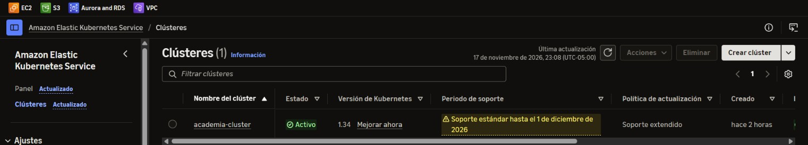

* **Evidencia 4.2 — Nodos de Cómputo EC2 en Ejecución:**  
  Instancias EC2 trabajadoras (`workers-free-Node`, tipo `t3.micro`) bajo la Capa Gratuita, todas en estado **En ejecución** y con **3/3 comprobaciones superadas**.  
  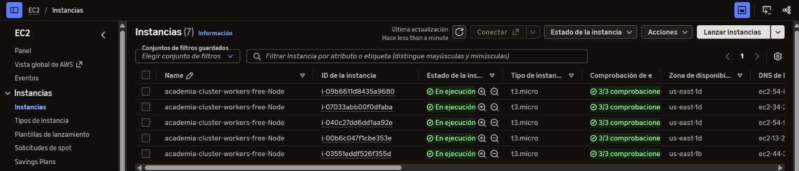

---

### Paso 5: Despliegue Continuo con GitOps mediante Argo CD
Sincronización declarativa del estado de Git con el clúster en tiempo real.

* **Evidencia 5.1 — Aplicación Sincronizada y Saludable (`Healthy` y `Synced`):**  
  Topología completa en Argo CD con pods de microservicios, bases de datos y job de precarga en estado verde.  
  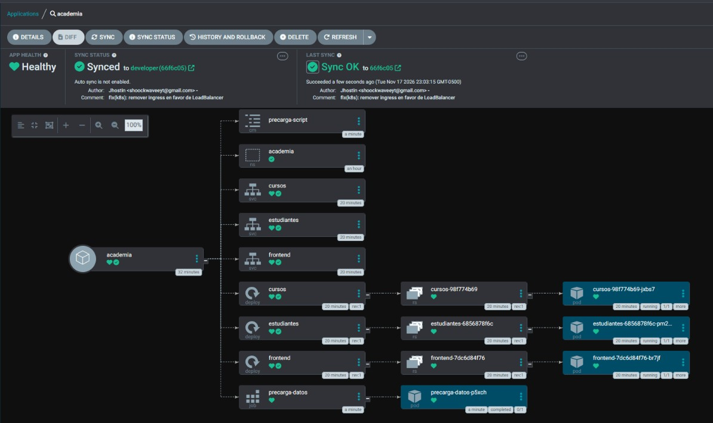

---

### Paso 6: Verificación de la Aplicación en Producción sobre AWS (Frontend Público)
La plataforma es accesible públicamente mediante el Balanceador de Carga de AWS (`LoadBalancer`) en el puerto 8080:  
**URL pública en AWS:** `http://a858930a9175a4492bd5f0c4acdc53c0-571400533.us-east-1.elb.amazonaws.com:8080`

* **Evidencia 6.1 — Panel General de Control con Métricas Vivas:**  
  El panel principal consulta a los servicios en vivo y muestra los datos precargados (8 cursos activos, 10 estudiantes y 8 matrículas).  
  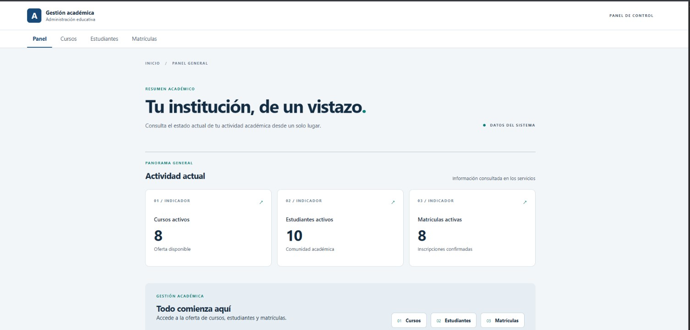

* **Evidencia 6.2 — Módulo de Gestión de Cursos:**  
  Catálogo con capacidades, estados y formulario de edición conectado a la API de Spring Boot en Kubernetes.  
  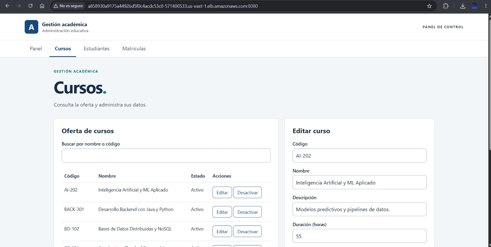

* **Evidencia 6.3 — Módulo de Gestión de Estudiantes:**  
  Directorio de estudiantes con documento, nombres y correo, conectado a la API de FastAPI en Kubernetes.  
  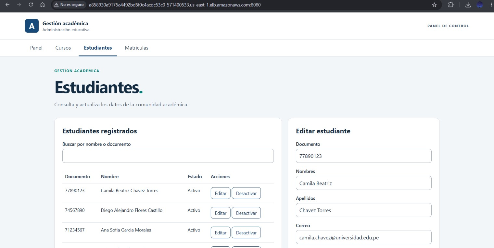

* **Evidencia 6.4 — Módulo de Gestión de Matrículas:**  
  Inscripción dinámica con cálculo atómico de plazas (*"19 de 20 plazas disponibles"*) y cancelación funcional.  
  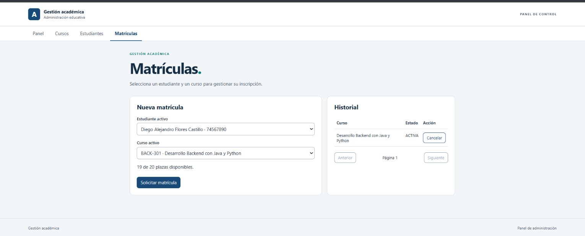

---

## 8. Fuentes de referencia

- [Anthropic: Effective harnesses for long-running agents](https://www.anthropic.com/engineering/effective-harnesses-for-long-running-agents).
- [Argo CD: Declarative GitOps CD for Kubernetes](https://argo-cd.readthedocs.io/en/stable/).
- [AWS: Uso de imágenes de Amazon ECR con Amazon EKS](https://docs.aws.amazon.com/AmazonECR/latest/userguide/ECR_on_EKS.html).
- [GitHub: Configuración de OpenID Connect en Amazon Web Services](https://docs.github.com/en/actions/how-tos/secure-your-work/security-harden-deployments/oidc-in-aws).
